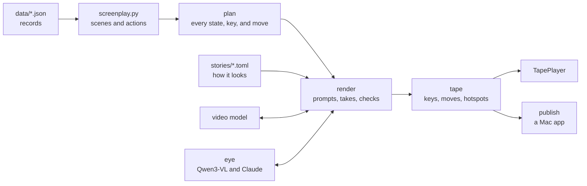

# Videotape

Videotape is a framework that delivers an app as video. You write the app as a screenplay: its screens in Python, its data in JSON, and how it looks in a story. One video model renders every screen and every transition into a tape. A player rests on the tape's frames, maps clicks to the controls drawn in them, and plays the clip of each press. To the person using it, the tape is the app.

The goal is video as a user interface. No HTML, widgets, or layout code draw anything. The model draws every pixel, and Videotape checks each frame against the screenplay's exact words.

This is a research prototype. It runs on macOS. The finished demo, a flight-booking app called [Contrail](examples/contrail), renders 150 shots per look, and its measured results and shortfalls are [below](#example-contrail).

To click through Contrail in your browser, open the website: [arjmandi.github.io/videotape](https://arjmandi.github.io/videotape/). The paper, a preprint on Zenodo, reports every measurement: [doi:10.5281/zenodo.24511068](https://doi.org/10.5281/zenodo.24511068).

- [How it works](#how-it-works)
- [Getting started](#getting-started)
- [Example: Contrail](#example-contrail)
- [Architecture](#architecture)
- [What it can't do yet](#what-it-cant-do-yet)
- [The developer's guide](docs/guide.md) builds Contrail from an empty folder, step by step.

## How it works

You write three things. Videotape turns them into a tape.



### A screenplay holds every word and nothing about looks

A scene is a Python function that returns the elements of one screen, top to bottom. Calling a scene names a state: the scene with one set of arguments. An element with `to=` holds an action, which leads to the state it names.

```python
app = vt.Screenplay("Contrail")


@app.scene
def search():
    options: list[vt.Option] = []
    for place in airports.where(lambda a: a.code != "SFO").order_by("city"):
        go = dates(place) if served(place) else no_flights(place)
        options.append(vt.Option(f"{place.city} ({place.code})", to=go))
    return [vt.SearchBar("Where to?", options=options, no_match=not_found())]
```

The elements are `Heading`, `Text`, `Button`, `SearchBar` with its `Option`s, `DatePicker`, `DateStrip`, `List` with its `Row`s, `BarChart`, `LineChart`, and `Tabs`. Data comes from typed records (`vt.Record`) loaded from JSON arrays under `data/` with `vt.table`. Contrail's screenplay passes pyright in strict mode.

### A story says how everything looks

A story is a TOML file. It gives the look that opens every prompt, a direction for each scene, an appearance for each type of element, and what the camera does in each kind of move. Two stories turn one screenplay into two apps that look nothing alike, with no change to the code.

```toml
look = """
A quiet international airport terminal at first light. Polished pale terrazzo, tall glass walls onto
the runway, brushed steel, warm walnut, and low golden sun.
"""

[scenes]
results = "The departure board, showing one day's flights."

[elements]
Button = "a lit amber panel with bold black letters, like a gate sign"

[moves]
Button = "The panel lights up as it is pressed. The camera walks forward."
```

### The plan walks every state before anything renders

`videotape plan` starts at the first scene and follows every action. The data decides how many states there are. Contrail reaches 58 states through 102 actions. The plan reports logical errors, such as a scene nothing reaches, and prints the price range of a render on the chosen model.

```text
Contrail 0.1.0 + terminal 1.0.0: 11 scenes, 58 states, 58 keys of which 10 rehearsed, 102 moves, 150 shots
```

Each state becomes a **key**, the still frame the player rests on. Each action becomes a **move**, the clip that plays when you press it.

### The render films shots in the order the pictures depend on each other

A render turns the plan into shots and films them in this order:

1. **The entry's key**, from its prompt alone (text to video). Its last frame is the app's first screen.
2. **Each scene's base**, which is the scene's first state in the plan. Videotape rehearses it: the model films the move that first reaches it, starting from the key it leaves (image to video). The clip travels from one screen to the next, and its last frame becomes the base's key.
3. **Each variant**, a later state of the same scene that differs only in its data. The model draws it from the base's picture with the variant's own words, so every variant keeps the base's layout.
4. **Every other move**, filmed between its two finished keys (first and last frame).

The prompt for each shot is compiled from clauses. Each clause records where it came from: a line of the story, an element of the screenplay, or an engine rule. `videotape shots` prints them.

### Every take is checked against the screenplay

A shot films one take at a time, with seeds 1, 2, 3, and on. After each take of a key, the eye reads the frame back. The eye is two readers from different model families, Qwen3-VL-8B running locally and Claude running as a service. A line passes only if both read it exactly. Two readers catch what one reader misses, because a vision model tends to read the word it expects, such as "Email" where the frame says "Eaal". Claude also judges every move from eight frames across it.

| Code | The take fails when |
|---|---|
| `VT501` | an action's words aren't found on the key |
| `VT502` | a line doesn't read back exactly from every reader |
| `VT503` | the key shows something that looks like a control the state doesn't have |
| `VT504` | a chart's title, labels, or values don't match the data within 10% |
| `VT505` | a variant's layout drifts from its scene's base |
| `VT506` | a move cuts |
| `VT507` | a move dissolves, showing two pictures overlaid |
| `VT508` | a move doesn't start and end on its keys |
| `VT509` | the chosen day or tab isn't the one drawn marked |

A shot keeps the first take that passes every check. If no take passes within the limit, it keeps the best one, and the failure goes to the dailies. You can then retake the shot, change the screenplay or the story and render again, or accept the failure with a written reason.

### The tape keeps the facts outside the pixels

The tape is a folder. `tape.json` holds each state's words, its hotspots (the boxes where the eye found each action's words), the state graph, and a label with a hash of everything that made it. `keys/` and `moves/` hold the frames and clips. The player exposes each state's words to macOS accessibility straight from `tape.json`, so the words a screen reader hears are always exact, even when a frame's pixels are not.

A render run again reuses every take on disk and films only what changed. Change one fare in the data, and Videotape films again only the shots that show that fare and the shots drawn from them.

### Every paid call has a cap and a ledger line

A render stops before any call that would spend more than its cap (`VT402`). `ledger.jsonl` holds one line per take, read, and judgment, with its price, so a render that resumes never pays twice for the same take.

## Getting started

You need a Mac with:

- [uv](https://docs.astral.sh/uv/).
- ffmpeg, from `brew install ffmpeg`.
- Xcode from the App Store, which builds the player. The Command Line Tools alone can't build it.

### Render a starter app for free

Make a project:

```sh
uvx --from git+https://github.com/arjmandi/videotape videotape new myapp
cd myapp
uv run videotape doctor
```

`doctor` names each missing tool or API key, with its fix. It never prints a key. The two failing key checks don't matter for the stand-in.

Render with the stand-in. The stand-in is a model that needs no API key and no GPU, and costs nothing. It draws each line of words as a box, so it tests everything except the pictures.

```sh
uv run videotape render --story starter --model stand-in
```

```text
1. key home()  kept take 1, passed, 1 take filmed, $0.00, 0.2 s
2. key todo() rehearsed from home()  kept take 1, passed, 1 take filmed, $0.00, 0.2 s
3. todo() -> home() "Back"  kept take 2, passed, 2 takes filmed, $0.00, 0.3 s
3 shots, 4 takes filmed, $0.00, 3.0 s, tape 0.2 MB -> tapes/starter
```

Play it:

```sh
uv run videotape play --story starter
```

The first `play` builds TapePlayer. Then it opens on the starter's first screen. Click **See the steps**.

### Render with a real model

1. Add the `qwen` extra, which runs the local reader. In `pyproject.toml`, change `"videotape @ ..."` to `"videotape[qwen] @ ..."`, then run `uv sync`. The local reader needs Apple silicon or a CUDA GPU.
2. Copy `.env.example` to `.env`, and set `FAL_KEY` and `ANTHROPIC_API_KEY` there.
3. Set `model = "gemini-omni-flash-1.2"` under `[tool.videotape]` in `pyproject.toml`.
4. Read the estimate with `uv run videotape plan --story starter`.
5. Render with `uv run videotape render --story starter`.

These are the models Videotape can render with:

| Model | Where it runs | Price |
|---|---|---|
| `stand-in` | locally | free |
| `gemini-omni-flash-1.2` | fal, 720p | $0.0819 a second of clip, plus up to $0.03 a call |
| `wan3.0` | fal, 720p | $0.10 a second |
| `minimax-h3` | fal, 1344x768 | $0.06 a second |
| `wan2.2-5b` | one CUDA GPU, through the `wan` extra. `scripts/runpod-render` rents one on Runpod. | the GPU's hourly price |

Contrail uses `gemini-omni-flash-1.2`. A screen test filmed eight of Contrail's keys on each fal model, and 80.0% of its elements passed every check, against 56.7% for `wan3.0` and 55.8% for `minimax-h3`. Claude's reads and judgments are billed per call under the same cap.

### Review, fix, and publish

| Command | What it does |
|---|---|
| `videotape plan` | walks every state, reports errors, and prints the estimate |
| `videotape shots --story <s>` | prints each shot's prompt, with the source of each clause |
| `videotape render --story <s>` | films the tape, resuming from what is on disk |
| `videotape dailies --story <s>` | opens the review page: failures first, with what each reader read and a crop of the frame |
| `videotape explain <code>` | prints an error code's long form, an example, and its fix |
| `videotape retake "<state>" --story <s>` | films new takes of one shot and keeps the best |
| `videotape accept "<state>" <code> --story <s> --reason "..."` | marks a failing check as fine for the take you reviewed |
| `videotape play --story <s>` | opens the tape in TapePlayer |
| `videotape publish --story <s>` | makes a signed Mac app in `dist/` |
| `videotape diff <tape> <tape>` | says whether two tapes are of the same app and the same story, and how many states and moves they share |

`publish` refuses a tape that is out of date with its files (`VT601`) or that has a failing check nobody accepted (`VT602`). It re-encodes the clips as HEVC, reads each clip's last frame again to confirm the encoding broke no check (`VT604`), signs the app ad hoc, and records the tape's hash in `videotape.lock`.

## Example: Contrail

[examples/contrail](examples/contrail) is a demo that books one-way flights from San Francisco. Its screenplay is 159 lines. It has a home screen with the next trip, a destination search, a month calendar with fares, a day's flights with a strip of other days, flight details, booking with a confirmation code, a trips list, a profile with a bar chart and a line chart, and screens for searches that find nothing. Its data is 7 airports, 18 flights, 11 trips, and 1 traveler.

It has two stories. `terminal` sets each screen in a quiet airport terminal at first light. `posters` draws each screen as a 1960s screen-printed travel poster. Both rendered all 150 shots on `gemini-omni-flash-1.2` in November 2026. [report.md](examples/contrail/report.md) has the full numbers:

| | terminal | posters |
|---|---|---|
| First-take yield | 80 of 150 shots (53%) | 106 of 150 shots (71%) |
| Takes on the tape | 366 | 283 |
| Cost | $248.87 | $149.35 |
| Render time | 6.5 hours | 3.5 hours |
| Tape size | 304 MB | 329 MB |
| Published app, zipped | 58.5 MB | 55.2 MB |
| Text checks passed | 102 of 105 | 101 of 105 |
| Move checks passed | 399 of 408 | 408 of 408 |

Every button, list, date picker, date strip, search bar, heading, chart, and tab passed its checks on the kept takes, except for one list row in `posters`. The failures that remain were accepted for budget reasons, and [retry.md](examples/contrail/retry.md) gives the cause and the next fix for each.

The main shortfall is text in variants. A variant drawn from its base's picture sometimes keeps a few of the base's characters: "CT 500" for "CT 504", "AM" for "PM", or a mileage close to the base's. Retakes fix most of these, but seven needed more takes than the budget allowed. The tapes themselves aren't in the repository, because each is about 300 MB.

To render Contrail with the stand-in:

```sh
cd examples/contrail
uv run videotape render --story terminal --model stand-in
uv run videotape play --story terminal
```

Contrail depends on the `qwen` extra, so its first `uv run` installs PyTorch.

## Architecture

The repository holds the Python framework, the macOS player, the example app, and the scripts that measured the results.

```text
videotape/          the framework and the videotape command
clients/macos/      TapeKit (the tape format, in Swift) and TapePlayer (the Mac app)
examples/contrail/  the flight demo: screenplay, data, two stories, and its report
scripts/            measurements: screen test, reader test, words test, moves test, report, and a Runpod render
tests/              the Python test suite, including one that runs the developer's guide
docs/guide.md       the developer's guide
```

The `videotape` package splits along the layers above.

| Layer | Modules | What they do |
|---|---|---|
| Screenplay | `screenplay.py`, `data.py` | elements, scenes, states, records, and tables |
| Plan | `plan.py` | walks the states and lists the keys, moves, and shots, with their order and modes |
| Story | `story.py` | parses a story and compiles each shot's prompt from sourced clauses |
| Models | `model.py`, `hosted.py`, `fal.py`, `wan.py`, `standin.py` | one interface for every model, with its modes, prices, and prompt limits |
| Eye | `checks.py`, `qwen.py`, `claude.py`, `layout.py`, `frames.py` | the readers, the judge, and the checks `VT501` to `VT509` |
| Render | `render.py`, `ledger.py`, `made.py` | films the shots, retries, enforces the cap, writes the tape, and hashes what made it |
| Review | `dailies.py`, `errors.py` | the dailies page, and every error code with its long form and fix |
| Ship | `publish.py`, `player.py` | builds TapePlayer, plays a tape, and publishes a Mac app |
| Project | `project.py`, `new.py`, `doctor.py`, `cli.py` | the project's `pyproject.toml` settings, the starter, the machine check, and the commands |

TapePlayer rests on the last frame of a key, maps a click to a hotspot, plays the move, and plays a move backward to go back. Typing in a search bar opens the platform's text sheet. The typed text picks the matching option, or goes to the search's `no_match` state.

Run the tests:

```sh
uv sync
uv run pytest
clients/macos/test.sh
```

The Python suite needs ffmpeg, but no API key, and makes no paid call. The tests replay recorded answers from the paid services. `clients/macos/test.sh` runs TapeKit's unit tests and TapePlayer's UI tests. The UI tests take over the mouse and screen, and they play `examples/contrail/tapes/terminal`, so render it with the stand-in first.

## What it can't do yet

- **The player runs only on macOS.** Players for iOS, the web, and Android are the next milestone.
- **A tape holds a finite set of states.** Every state is rendered before anyone plays it. Typed text must match one of the search's options. There is no free text, no date outside the data, and no state the screenplay doesn't reach.
- **Nothing is kept between screens.** In Contrail, a booking shows its confirmation, but it doesn't appear in Trips afterwards.
- **Pixels can still be wrong.** The words in `tape.json` are exact, and the checks catch most wrong pixels. The model still misdraws some lines, and a person accepts or retakes those.
- **Rendering costs real money.** A full Contrail story costs $150 to $250 on fal.

## Status

Videotape is in its second prototype. Prototype 1 showed that one model can draw a small app and that a player can click through it. Prototype 2 built Contrail to test the developer's path and the render of each element. The paper on the results is a preprint on [Zenodo](https://zenodo.org/records/24511068).

## License

Apache License 2.0. See [LICENSE](LICENSE).
