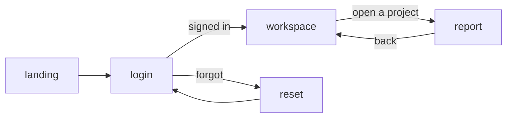

# Getting started with Videotape (Python)

**Date:** 2026-10-23 · **Status:** design draft. Nothing here runs yet. This guide was written
before any v2 code to test [05-design-v2.md](05-design-v2.md) against real apps. Where an app
needed something the design does not have, the guide uses a proposed API and marks it
`proposed, Fn`; each Fn is a finding in [07-review-from-apps.md](07-review-from-apps.md).

---

## 1. What you write, and what you don't

A Videotape app is a Python program that says what users come to do. You write:

- **Tapes**: the journeys users take, such as signing in, watching a video, or closing a deal.
- **Frames**: the steps of a journey, each with a one-line purpose and the components the user
  needs at that step.
- **Handlers**: async functions that decide where the journey goes next.
- **Loaders**: functions that fetch what a frame shows from your own database and services.

You do not write layouts, styles, breakpoints, a screen per device, navigation stacks, or any
client code. A designer declares a **world**. The engine composes each frame for the real screen,
turns each component into an object of the world, draws your data as real text, and plays the app
on the web, iOS, Android, and desktop.

| You write | The engine does |
|-----------|-----------------|
| Tapes, frames, and components with roles | Composition for every screen size and orientation, continuously |
| Handlers and loaders in Python | Calls them over the app protocol, after validating every event |
| Your data | Draws it as text in the world, exactly; generation never touches it |
| A name for each component | The native accessibility tree on every platform |
| Nothing for text input | The platform's own editors, with IME, autofill, and password managers |
| `videotape export` | A native client for each store, from the same app |

## 2. Your first app

### 2.1 Install and create

```bash
pip install videotape
videotape new hello
cd hello
videotape dev
```

```
hello/
  app.py            tapes, frames, handlers
  world.py          the world (or the plain world until a designer has one)
  services.py       your database, auth, and APIs
  videotape.toml    app id, engine address, export targets, store ids
  tests/
    test_journeys.py
```

`videotape dev` starts a local engine with generation off, runs your app process beside it, and
opens the web client. Edits reload in place, and the user's place in the journey survives a reload
when its frame still exists. `videotape dev --ios` builds the iOS client for the Simulator. How the
local engine renders on a laptop without a server GPU is F26.

### 2.2 A landing page and a sign-in

```python
# app.py
import videotape as vt
from services import auth, db

landing = vt.tape("landing", frames=[
    vt.frame("intro", purpose="Say what Hello is and lead to sign-in", components=[
        vt.text("headline", "Hello, team.", role="heading"),
        vt.text("pitch", "Plans, notes, and decisions in one quiet place.",
                role="supporting", relations={"summarises": "headline"}),
        vt.button("start", "Sign in", role="primary", on_press=vt.jump("login")),
    ]),
])

@vt.handler(outcomes=[vt.jump("workspace"), vt.stay()])
async def sign_in(ctx):
    user = await auth.login(ctx.values["email"], ctx.values["password"])
    if user is None:
        return vt.stay({"login.error": "That email and password do not match."})
    return vt.jump("workspace", {"user": user.public()}, sign_in=user.id)   # sign_in: proposed, F7

login = vt.tape("login", frames=[
    vt.frame("form", purpose="Sign in", components=[
        vt.text("title", "Welcome back", role="heading"),
        vt.input("email", label="Email", type="email", required=True, group="credentials"),
        vt.input("password", label="Password", type="secret", required=True, group="credentials"),
        vt.text("error", bind="login.error", role="status"),
        vt.button("submit", "Sign in", role="primary", on_press=sign_in),
        vt.button("forgot", "Forgot your password?", role="secondary", on_press=vt.jump("reset")),
    ]),
])

app = vt.app("hello", entry="landing", tapes=[landing, login, reset, workspace],   # reset and workspace
             world="dusk-studio")                                                   # are left out here
```

- `role`, `group`, and `relations` tell the composer what matters and what belongs together. There
  are no positions, containers, rows, or spacers.
- `on_press` takes a static action (`jump`, `goto`, `back`) or a handler. Static actions and the
  handler's declared `outcomes` are the edges of your journey graph.
- `type="secret"` values reach your handler once. They are never stored, logged, or drawn; the
  engine draws masking dots.
- `bind="login.error"` shows a value from the reel's store, and `stay({...})` patches it without
  leaving the frame.
- Everything except handler bodies serialises to the JSON intent of the design (§6), so a
  TypeScript app declares the same thing.

### 2.3 What appears

The sign-in frame in the `dusk-studio` world, a recording studio at dusk:

- **Phone, portrait.** The title is a tape label across the top. The two fields are channel strips
  on the console, stacked. "Sign in" is a lit console key under the thumb, and the error appears on
  a small meter display. Tapping a strip opens the platform's own editor over it.
- **Phone, landscape.** The camera turns with the device; the console moves to one side and the
  room fills the other. Nothing reloads.
- **Desktop.** The camera pulls back. Tab moves between strips; Enter presses the lit key.
- **Watch (after M3).** One strip per step: email, then password, then the key, with the title
  pinned.
- **Plain mode.** The same frame as flat, high-contrast panels, which any user can switch to at
  any time.

None of this is in your code. Change the world and every screen changes; change a frame and every
world follows.

## 3. Thinking in journeys

### 3.1 From goals to tapes

Start with what users come to do, not with screens. Write each goal as a sentence with a verb:
"sign in", "find a video and watch it", "reply to a message", "move a deal to the next stage". Each
goal is a tape, and a tape ends when the goal is reached or abandoned.

Then the steps. A frame is a point where the user must see something or decide something. Give it
a one-line `purpose`. If the purpose does not fit in one line, it is two frames, or the goal is two
tapes.

Then what the user needs at each step: the components, each with a `role` (heading, primary,
secondary, navigation, status, supporting) and an `importance` (required, normal, optional). Group
what belongs together; say how items relate (`labels`, `summarises`, `dependsOn`, `follows`).

Last, the decisions. Handlers return outcomes; declare them so the graph knows every edge and
`videotape check` can find dead ends.

### 3.2 A journey map

`videotape graph` draws the map from your code:



### 3.3 Rules of thumb

- **One purpose per frame.** Two purposes compete for the primary role.
- **Don't design for a screen.** Mark what can go when room is short as `importance="optional"`.
- **Don't split long forms yourself.** Declare groups; the composer splits a form into steps on a
  watch and merges frames on a wall (M3).
- **Keep facts in data.** Every string and number you show is drawn exactly by the engine; never
  put them in a world's prompt.
- **Name actions by intent**, such as "like" or "archive", not by gesture. The client maps gestures
  per platform, and every action stays reachable by keyboard and screen reader (proposed, F10).
- **Handlers decide; they do not draw.** They return outcomes and data, never presentation.

### 3.4 Moving through an app

| Action | Meaning | Status |
|--------|---------|--------|
| `goto(frame)` | The next step in the same tape | Designed (v1) |
| `jump(tape, data)` | Switch journey; the current place goes on the history stack | Designed (v1) |
| `back()` | Return to the previous place | Designed (v1) |
| `stay(patch)` | Remain, and patch the reel's store | Designed (v1) |
| `hub(destinations)` | Top-level destinations the user moves between freely, each with its own history: a tab bar on a phone, a sidebar on a desktop, a list on a watch | Proposed, F5 |
| `call(tape, then=handler)` and `done(result)` | A detour that returns a result: pick a company, confirm a deletion. The composer may show it as a sheet over the caller | Proposed, F5 |

```python
app = vt.app("relay", entry="chats", tapes=[chats, thread, contacts, settings],
             hub=vt.hub([vt.destination("chats", "Chats", symbol="chat"),        # proposed, F5
                         vt.destination("contacts", "Contacts", symbol="person"),
                         vt.destination("settings", "Settings", symbol="gear")]))
```

## 4. Components

| Component | For | Status |
|-----------|-----|--------|
| `text` | Headings, copy, values, status | Designed (v1) |
| `input` | Typing: text, email, number, money, search, secret; `lines=` for multi-line | Designed (v1); `money` and `lines` proposed, F27 |
| `button` | An action | Designed (v1) |
| `select`, `toggle`, `slider`, `date` | Choosing | Designed (v1) |
| `image` | Pictures from your data: avatars, photos, thumbnails. Never generated | Designed (v1); facts rule proposed, F15 |
| `media` | Video and audio, played by the platform's own player | Designed (v1); native surface proposed, F16 |
| `collection` | Lists, tables, grids, and feeds of records, with paging | Proposed, F4 (replaces v1 `list`) |
| `rich_text` | Formatted text: paragraphs, emphasis, links, lists, code, mentions | Proposed, F17 |
| `chart` | Numbers as a chart, drawn by the engine from data | Proposed, F19 |

Every component has an `id`, a `role`, an `importance`, and an optional `group`. Components never
take a position, size, colour, or font.

## 5. Data and state

### 5.1 Loaders and the reel's store

Each user has a **reel**: where they are, their history, and a small store of journey data. A
frame's `enter` loader fills the store from your services when the user arrives:

```python
async def load_workspace(ctx):
    return {"projects": await db.projects(owner=ctx.user.id)}     # ctx.user: proposed, F7

vt.frame("overview", purpose="See your projects", enter=load_workspace, components=[...])
```

Your database stays yours; the store holds only what the current journey shows. Typed values
travel with the submit by default; `commit="change"` sends them as the user types, for search.

### 5.2 Collections (proposed, F4)

```python
project_row = [
    vt.text("name", bind="item.name", role="heading"),
    vt.text("status", bind="item.status", role="status"),
    vt.text("updated", bind="item.updated", format="relative-time"),
]

vt.collection("projects", source="projects", fields=["name", "status", "updated"],
              item=project_row,
              on_select=vt.jump("report", {"project_id": vt.item("id")}),
              empty=[vt.text("none", "No projects yet.")])
```

Long and endless lists take a paged source:

```python
async def feed_page(ctx, cursor):
    posts, next_cursor = await db.feed(ctx.user.id, after=cursor, limit=20)
    return vt.page(posts, next=next_cursor)

vt.collection("posts", source=vt.pages(feed_page), item=post)
```

The composer chooses the shape: a table on a desktop when the `fields` can be compared, cards on a
phone, one record at a time on a watch. `vt.item(...)` and `vt.data(...)` are placeholders the
engine fills, so static actions stay data and need no round trip to Python.

### 5.3 Things that happen without the user (proposed, F6)

```python
vt.frame("messages", purpose="Read and reply",
         live=["conversation:{conversation.id}"], components=[...])

# anywhere in your app process
await app.publish(f"conversation:{cid}", {"messages": vt.append(message)})
```

Every session showing that conversation gets the patch, as if a handler had returned
`stay(patch)`. Frames can also run timers: `after=vt.after(seconds=5, then=vt.goto("next"))`.

### 5.4 Who is signed in (proposed, F7)

`sign_in=user.id` on an outcome tells the engine who the user is. Their reel then resumes on any
device, `ctx.user` is set in every handler and loader, and your app can publish to a user with
`app.publish_to(user_id, patch)`.

## 6. Worlds

```python
# world.py
import videotape as vt

dusk_studio = vt.world("dusk-studio", kind="3d",
    prompt="A recording studio at dusk: warm wood, tape machines, soft amber light, quiet.",
    palette={"base": "#1c1612", "ink": "#f4ead9", "accent": "#ff8a3d"},
    embody={"button.primary": "a lit console key",
            "collection": "tape reels on a shelf, one per item"})
```

- Worlds start in 3D (decision J); 2.5D and 2D follow. One world per app, overridable per tape.
- Generation happens at release time, once, for every user (decision I). With generation off you
  get the default assets, which is also how CI runs.
- Until a designer declares a world, use the plain one, which is also the mode every user can
  switch to.

## 7. Check, test, release, export, run

### 7.1 Journey tests

```python
# tests/test_journeys.py
from videotape.testing import play
from app import app

async def test_wrong_password_stays_on_the_form(fake_services):
    s = await play(app, start="login", services=fake_services, screen="phone")
    await s.fill(email="ada@example.com", password="nope")
    await s.press("submit")
    assert s.at("login", "form")
    assert s.text("error") == "That email and password do not match."
```

Tests run the journey runtime and the composer with generation off, without a GPU or a device.
`s.composition` lets a test check what the composer did on that screen, such as the primary action
being within reach.

### 7.2 Static checks

`videotape check` finds unreachable frames, dead ends, undeclared outcomes, and binds to secrets,
and runs the composer on the reference screens (watch, phone in both orientations, tablet, desktop,
wall) to check edges, reach, and minimum sizes.

### 7.3 Releases

`videotape release` runs embodiment and world generation once, checks the assets, and produces the
world pack. It then sorts your changes, because the stores accept presentation changes from a
server but new features only in reviewed builds (design §7.1):

```
$ videotape release
world pack     dusk-studio@14: 2 props regenerated, harness passed
presentation   copy in landing.intro; composition of workspace.overview    live for every client
features       new tape "share"                                             store builds needed: ios, android
```

### 7.4 Exports

`videotape export ios android desktop web` produces client projects, which you sign and submit
from your own developer accounts (design §11.1). The iOS client renders on the device (decision K);
the others play a stream. Each build carries the list of features it was reviewed with.

### 7.5 Running in production

Two processes. The engine runs as a container, with a GPU for streamed sessions; iOS sessions need
none. Your app process connects out to the engine, so it can run wherever your data is:

```bash
docker run --gpus all -p 443:443 videotape/engine
python -m videotape serve app:app --engine wss://engine.example.com
```

## 8. Five apps, sketched

Each sketch shows the journeys, the interesting code, what the engine does with it, and what is not
possible yet. The code uses the proposed APIs where the design has none.

### 8.1 A web app: the demo (landing, docs, sign-in, dashboard, report)

**Journeys.** Read about the product (landing), learn it (docs), sign in, see my projects
(dashboard), read one report.

```python
@vt.handler(outcomes=[vt.stay()])
async def search_docs(ctx):
    return vt.stay({"results": await docs_index.search(ctx.values["q"], limit=8)})

docs = vt.tape("docs", frames=[
    vt.frame("page", purpose="Read one page of the docs",
             address="/docs/{page}",                                   # proposed, F8
             enter=load_page, components=[
        vt.text("title", bind="page.title", role="heading"),
        vt.rich_text("body", bind="page.markdown", format="markdown"),  # proposed, F17
        vt.collection("toc", source="toc", role="navigation",           # proposed, F4
                      item=[vt.text("entry", bind="item.title")],
                      on_select=vt.jump("docs", {"page": vt.item("slug")})),
        vt.input("q", label="Search the docs", type="search", commit="change",
                 on_change=search_docs, importance="optional"),
        vt.collection("results", source="results", role="supporting",
                      item=[vt.text("hit", bind="item.title")],
                      on_select=vt.jump("docs", {"page": vt.item("slug")})),
    ]),
])

dashboard = vt.tape("dashboard", frames=[
    vt.frame("overview", purpose="See how my projects are doing", enter=load_projects,
             address="/projects", components=[
        vt.text("greeting", bind="user.first_name", format="Hello, {}", role="heading"),
        vt.chart("activity", kind="line", source="activity", x="week", y="events",
                 importance="optional"),                               # proposed, F19
        vt.collection("projects", source="projects", fields=["name", "status", "updated"],
                      item=project_row,
                      on_select=vt.jump("report", {"project_id": vt.item("id")})),
    ]),
])
```

**What the engine does.** In a browser on a desktop, the page title and body sit on a reading
surface, the table of contents on a navigation surface beside it, search within reach. On a phone,
the table of contents folds behind a navigation object and the body takes the screen. Each docs
page has a URL; the browser's back button walks the reel's history. The dashboard's projects
become a sortable table on a desktop and cards on a phone.

**Not yet, or not well.** Search engines and link previews see nothing in a stream (F21).
Copying a code sample, Ctrl+F, and printing need help (F18). Long text must stay crisp through the
video encoder (F1) and scroll without lag (F2). Long documents and tables want flat surfaces rather
than world props (F3).

**Compared with today.** A React front end, an API, a design system, and responsive CSS become
frames and loaders in Python. The public landing page should stay an ordinary website until F21 is
decided.

### 8.2 A video platform ("Screening")

**Journeys.** Browse what is new (home), search, follow channels (subscriptions), watch a video
and decide what next, visit a channel. Uploading needs the camera and files (M4).

```python
video_card = [
    vt.image("thumb", bind="item.thumbnail", alt="item.title", role="primary"),   # facts: F15
    vt.text("title", bind="item.title", role="heading"),
    vt.text("meta", bind="item.channel.name", role="supporting"),
]

home = vt.tape("home", frames=[
    vt.frame("shelves", purpose="Find something to watch", enter=load_shelves, components=[
        vt.collection("shelves", source="shelves", item=[                    # nested: F4
            vt.text("name", bind="item.title", role="heading"),
            vt.collection("videos", source="item.videos", item=video_card,
                          on_select=vt.jump("watch", {"video_id": vt.item("id")})),
        ]),
    ]),
])

watch = vt.tape("watch", frames=[
    vt.frame("video", purpose="Watch a video and decide what next",
             address="/watch/{video_id}", enter=load_video, components=[
        vt.media("player", source="video.stream", kind="video",              # native surface: F16
                 captions="video.captions", role="primary", importance="required",
                 on_ended=vt.jump("watch", {"video_id": vt.data("up_next.0.id")})),
        vt.text("title", bind="video.title", role="heading"),
        vt.button("channel", bind="video.channel.name", role="navigation",
                  on_press=vt.jump("channel", {"channel_id": vt.data("video.channel.id")})),
        vt.button("subscribe", "Subscribe", on_press=subscribe,
                  hidden="video.channel.subscribed"),                       # proposed, F9
        vt.rich_text("description", bind="video.description", importance="optional"),
        vt.collection("up_next", source="up_next", item=video_card,
                      on_select=vt.jump("watch", {"video_id": vt.item("id")})),
        vt.collection("comments", source=vt.pages(comments_page), item=comment,
                      importance="optional"),
    ]),
])

app = vt.app("screening", entry="home", tapes=[home, search, subscriptions, watch, channel],
             hub=vt.hub([vt.destination("home", "Home", symbol="house"),
                         vt.destination("search", "Search", symbol="magnifier"),
                         vt.destination("subscriptions", "Subscriptions", symbol="list")]),
             world="screening-room")
```

**What the engine does.** The world is a screening room, and the player is a screen prop. The
client's own video player draws the video on that screen's surface, so playback, captions,
picture-in-picture, and casting are the platform's. On a phone turned to landscape, the composer
gives the required primary media the whole screen. On a desktop, up next sits beside the player.
On a TV later, the same frames are driven by a remote.

**Not yet.** Uploads (M4). Protected (DRM) video plays only in the native player, which the
stream cannot replace (F16). Live chat beside a live stream needs pushes (F6).

**Watch for.** A viewer watching a two-hour film holds a UI session that does nothing: it should
suspend while only the media plays (F20). Thumbnails are facts drawn at stream quality on streamed
clients (F15).

**Compared with today.** Video platforms keep a client team per platform (web, iOS, Android, TV).
Here one app plays on all of them, and only the media player is native, which is where the
platform-specific work belongs anyway.

### 8.3 A photo-sharing app ("Pinhole")

**Journeys.** See what people I follow posted (feed), discover (explore), see who reacted
(activity), look at someone (profile), watch stories. Posting needs the camera and photo library
(M4).

```python
@vt.handler(outcomes=[vt.stay()],
            optimistic={"item.liked": True, "item.likes": vt.increment(1)})   # proposed, F11
async def like(ctx):
    await db.like(ctx.user.id, ctx.item["id"])
    return vt.stay()

post = [
    vt.image("avatar", bind="item.author.avatar", alt="item.author.name"),
    vt.button("author", bind="item.author.name", role="navigation",
              on_press=vt.jump("profile", {"user_id": vt.item("author.id")})),
    vt.image("photo", bind="item.photo", alt="item.alt", role="primary",
             actions=[vt.action("like", "Like", gesture="double-tap", run=like)]),   # proposed, F10
    vt.button("like", "Like", on_press=like, hidden="item.liked"),              # F9
    vt.button("unlike", "Liked", on_press=unlike, visible="item.liked"),
    vt.text("likes", bind="item.likes", format="count"),
    vt.rich_text("caption", bind="item.caption", format="mentions"),            # proposed, F17
    vt.button("comments", "Comments", on_press=vt.jump("post", {"post_id": vt.item("id")})),
]

feed = vt.tape("feed", frames=[
    vt.frame("home", purpose="See what people I follow posted",
             live=["user:{user.id}:feed"], components=[                         # proposed, F6
        vt.collection("posts", source=vt.pages(feed_page), item=post),
    ]),
])

stories = vt.tape("stories", frames=[
    vt.frame("slide", purpose="Watch one story", enter=load_slide, components=[
        vt.image("picture", bind="slide.image", alt="slide.alt", role="primary",
                 actions=[vt.action("next", "Next", gesture="tap-trailing", run=next_slide),
                          vt.action("previous", "Previous", gesture="tap-leading", run=previous_slide)]),
        vt.text("who", bind="slide.author.name", role="supporting"),
    ], after=vt.after(seconds=5, then=next_slide)),                             # proposed, F6
])
```

**What the engine does.** A quiet darkroom world keeps the photos in front. On a phone the feed
is a single column; on a desktop the composer puts the feed in a column with the profile beside
it; on a watch it shows one post at a time. Double-tap on a photo likes it, and the same action
appears as "Like" in the screen reader's actions and as a key on a desktop.

**Not yet.** Posting, filters, and the photo library (M4); push notifications (M4); the share sheet
(M4). Shared links to a post need addresses (F8).

**Watch for.** Scrolling is the main gesture of the app, and over a stream it must not lag (F2).
Photos are the product, and on streamed clients they arrive at the stream's quality (F15, F1).
Streaming also costs data: at 5 Mbps, an hour of scrolling is 2.25 GB.

**Compared with today.** The feed, profile, and explore screens, with their phone, tablet, and
desktop variants, are four frames. The hard parts of a social app (ranking, moderation, the
social graph) stay in your services, where they are today.

### 8.4 A chat app ("Relay")

**Journeys.** See my conversations, read and reply in one, start a new one, manage a group.

```python
@vt.handler(outcomes=[vt.stay()],
            optimistic={"messages": vt.append({"key": vt.key(), "text": vt.value("draft"),
                                               "mine": True, "pending": True}),
                        "draft": ""})                                         # proposed, F11
async def send(ctx):
    msg = await db.send(ctx.data["conversation"]["id"], ctx.user.id,
                        ctx.values["draft"], key=ctx.key)
    await app.publish(f"conversation:{msg.conversation_id}",
                      {"messages": vt.append(msg.public())})                  # proposed, F6
    return vt.stay()

message = [
    vt.text("from", bind="item.author.name", role="supporting", hidden="item.mine"),
    vt.rich_text("body", bind="item.text", format="chat"),                    # links, mentions: F17
    vt.text("time", bind="item.sent_at", format="time", importance="optional"),
]

thread = vt.tape("thread", frames=[
    vt.frame("messages", purpose="Read and reply", address="/c/{conversation.id}",
             enter=load_thread, live=["conversation:{conversation.id}"], components=[
        vt.text("title", bind="conversation.title", role="heading"),
        vt.collection("messages", source=vt.pages(older_messages), order="oldest-first",
                      anchor="end", item=message, item_states=["mine", "pending", "unread"],
                      actions=[vt.action("reply", "Reply", gesture="swipe-trailing", run=start_reply),
                               vt.action("copy", "Copy", run=vt.copy("item.text"))]),   # F10, F18
        vt.text("typing", bind="conversation.typing", role="status", importance="optional"),
        vt.input("draft", label="Message", lines=(1, 6), group="reply"),
        vt.button("send", "Send", role="primary", on_press=send, group="reply"),
    ]),
])
```

**What the engine does.** When the keyboard opens, the client reports the new insets and the
composer keeps the reply group above the keyboard with the latest message in view (F12). The
native editor brings emoji, dictation, and every input method. A sent message appears at once,
marked pending, and settles when the server confirms it by key. On a desktop the conversation
list and the thread merge side by side (a declared merge, M3).

**Not yet.** Push notifications, attachments, and voice notes (M4). Calls are out of scope.

**Never.** End-to-end encryption. The engine draws every message, so it must read every message
(F22).

**Watch for.** Messages in any script and with emoji (F14); copying a message (F18); tapping a link
opens the browser (F23).

**Compared with today.** A real-time chat client is one of the harder things to build three times.
Here the client is the engine's, and your code is a store of messages and a publish call.

### 8.5 A CRM ("Pipeline")

**Journeys.** See open deals by stage and move them on, find a contact, review a contact's
history, create a deal, read the forecast.

```python
@vt.handler(outcomes=[vt.stay()], optimistic={"item.stage": vt.value("target")})
async def move_deal(ctx):
    deal = await db.move(ctx.item["id"], ctx.values["target"], by=ctx.user.id)
    await app.publish(f"team:{deal.team}:deals", {"deals": vt.replace(deal.public())})
    return vt.stay()

deals = vt.tape("deals", frames=[
    vt.frame("board", purpose="See every open deal by stage and move them on",
             enter=load_deals, live=["team:{user.team}:deals"], components=[
        vt.collection("deals", source="deals", group_by="stage", groups="stages",
                      fields=["name", "company", "amount", "owner"], item=deal_card,
                      on_select=vt.jump("deal", {"deal_id": vt.item("id")}),
                      actions=[vt.action("move", "Move to stage", target="group",
                                         gesture="drag", run=move_deal)]),         # F10
        vt.button("new", "New deal", role="primary", key="n", on_press=vt.jump("new_deal")),
        vt.button("export", "Export CSV", visible="user.can_export",                   # F9, F23
                  on_press=export_csv, importance="optional"),
        vt.chart("forecast", kind="bar", source="forecast", x="month", y="amount",
                 importance="optional"),                                          # F19
    ]),
])

@vt.handler(outcomes=[vt.stay()])
async def company_picked(ctx):
    return vt.stay({"deal.company": ctx.result["company"]})

new_deal = vt.tape("new_deal", frames=[
    vt.frame("form", purpose="Create a deal", components=[
        vt.input("name", label="Deal name", required=True, group="basics"),
        vt.button("company", bind="deal.company.name", label="Company", group="basics",
                  on_press=vt.call("pick_company", then=company_picked)),         # proposed, F5
        vt.input("amount", label="Amount", type="money", currency="deal.currency",
                 min=0, group="basics"),
        vt.select("stage", label="Stage", options="stages", group="basics"),
        vt.date("close", label="Expected close", group="dates"),
        vt.select("owner", label="Owner", options="team", group="people"),
        vt.input("notes", label="Notes", lines=(3, 12), importance="optional"),
        vt.button("save", "Create deal", role="primary", on_press=create_deal),
    ]),
])
```

**What the engine does.** A CRM is dense, so the board's columns and the contacts table sit on
flat surfaces that the world styles, in a quiet world (F3). On a desktop the board shows every
stage, drag moves a deal, and keys work; on a phone it shows one stage at a time with the next one
a swipe away; for keyboard and screen-reader users, "Move to stage" is a menu. "Pick company" opens
as a sheet over the form and returns the choice. A thirty-field record keeps its groups together
and, on a watch, becomes steps (M3).

**Not yet.** CSV import and export need files (M4, or the web download of F23). HTML emails in a
contact's timeline need a web view or conversion (F17). Charts are proposed (F19).

**Watch for.** Sales teams keep a CRM open all day, so idle sessions must cost almost nothing (F20).
Dragging a card over a stream must not lag (F2).

**Compared with today.** This is the internal-tool case: records, tables, forms, roles, and a
board, written in Python only, as with an admin framework, but with native apps on every device
and a look a designer controls.

## 9. What gets easier, and what does not

| Concern | Today | With Videotape |
|---------|-------|----------------|
| Clients | A web app plus iOS and Android apps: three codebases, or a cross-platform framework with per-platform work | One Python app; an export per platform |
| Screen sizes | Breakpoints and variants per size, orientation, and device class | The composer, for every size, continuously |
| Design system | Components in code on each platform, kept in step by hand | A world and its embodiments, generated once per release |
| Accessibility | Labels, roles, and focus order per platform, often late | From intent, native on every platform |
| Text input | Forms per platform | The platform's own editor, always |
| UI tests | Per platform, on devices or emulators | Journey tests in Python without a device; composer checks per reference screen |
| Releases | A store build for every interface change | Presentation from the server; store builds only for new features |
| A new look | A redesign project | A new world, released |

What gets harder, or is out of reach:

- **Running cost.** A streamed session uses a server GPU; iOS sessions do not (F20).
- **The network.** No offline use; on streamed clients, scrolling and dragging fight latency (F2).
- **Fidelity.** On streamed clients, text and photos pass through a video encoder (F1, F15).
- **Public web pages.** Search engines and link previews (F21).
- **Private messaging.** End-to-end encryption is impossible (F22).
- **Unusual interactions.** Anything outside the component vocabulary, such as a timeline editor
  or a map, needs an engine extension (F25).
- **Pixel control.** You steer a world, not pixels.

Where each app stands, assuming the findings in [07-review-from-apps.md](07-review-from-apps.md)
are adopted:

| App | At M1 | Waits for | Never |
|-----|-------|-----------|-------|
| Web app (the demo) | Yes, behind sign-in | Public pages and search engines (F21) | — |
| CRM | Yes | Charts (F19); file import and export (M4) | — |
| Video platform | Browsing and watching, if media surfaces land in M1 | Upload and DRM (M4) | — |
| Photo sharing | Browsing, liking, commenting | Posting and notifications (M4) | — |
| Chat | A working prototype | Notifications and attachments (M4) | End-to-end encryption |
