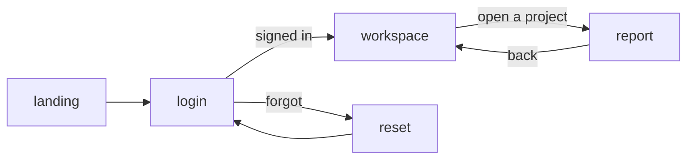

# Getting started with Videotape (Python)

**Date:** 2026-10-23 · **Status:** design draft, written against the decided design
([05-design-v2.md](05-design-v2.md) with Q24–Q30, 07's Q16–Q23, and the Python SDK's Q31–Q40 folded
in). A first SDK skeleton exists on a branch and predates Q31–Q40; nothing else runs yet. The first version of this guide was written before the design was settled and exposed the
findings in [07-review-from-apps.md](07-review-from-apps.md); this version shows the API those
findings produced.

---

## 1. What you write, and what you don't

A Videotape app is a Python program that says what users come to do, in three words:

- **Types**: records that say what exists. The engine turns them into inputs, lists, validation,
  labels, and the accessibility tree.
- **Places**: tapes of frames, each with a one-line purpose, what it shows or edits, and what can
  be done there.
- **Decisions**: handlers that say where the journey goes next, and loaders that fetch what a frame
  shows from your own database and services.

You do not write layouts, styles, breakpoints, a screen per device, navigation stacks, or any
client code. A designer directs a **world**. At release the engine lays your journey out in that
world as places joined by camera paths, embodies each field as an object or a surface, and draws
your data as real text. At runtime it composes each frame for the real screen with a camera, keeps
your data in documents it syncs to every screen, and plays the app on the web, iOS, Android, and
desktop, rendered on the device.

| You write | The engine does |
|-----------|-----------------|
| Records | Inputs, lists, validation, labels, message keys, and the native accessibility tree, from the types |
| Frames with a purpose, what they show, what can be done | A place in the world; a camera for every screen size and orientation, continuously |
| Handlers and loaders in Python | Calls them over the app protocol, after validating every event; everything the document can answer, it answers itself |
| Your data, as documents | Draws it as text in the world, exactly; syncs every change to every screen showing it; generation never touches it |
| Nothing for text input | The platform's own editors, with IME, autofill, and password managers |
| `videotape export` | A native client for each store, from the same app, rendering on the device |

## 2. Your first app

### 2.1 Install and create

```bash
pip install videotape
videotape new hello
cd hello
videotape dev
```

```
hello/
  app.py            tapes, frames, handlers
  records.py        the types your frames show and edit
  world.py          the world (empty until a designer has one; a built-in world until then)
  services.py       your database, auth, and APIs
  videotape.toml    app id, engine address, export targets, store ids
  tests/
    test_journeys.py
```

`videotape dev` starts a local engine with generation off, runs your app process beside it, and
opens the web client, which renders the scene in the browser exactly as production does. Edits
reload in place, and the user's place in the journey survives a reload when its frame still
exists. `videotape dev --ios` builds the iOS client for the Simulator. No GPU is involved: the
engine composes, the browser renders.

### 2.2 A landing page and a sign-in

```python
# records.py
import videotape as vt

class Credentials(vt.Record):
    username: str
    password: vt.Secret
```

```python
# app.py
import videotape as vt
from records import Credentials
from services import auth

landing = vt.tape("landing", [
    vt.frame("Say what Hello is and lead to sign-in", address="/", public=True,
             components=[
                 vt.text("Hello, team.", role="heading"),
                 vt.text("Plans, notes, and decisions in one quiet place.", role="supporting"),
             ],
             actions=[vt.action("Sign in", vt.jump("login"), role="primary")]),
])

async def sign_in(ctx, c: Credentials):
    user = await auth.login(c.username, c.password)
    if user is None:
        raise vt.Reject("That email and password do not match.")
    return vt.jump("workspace", sign_in=user)

login = vt.tape("login", [
    vt.frame("Sign in", title="Welcome back", edit=Credentials, submit=sign_in,
             actions=[vt.action("Forgot your password?", vt.jump("reset"), role="secondary")]),
])

app = vt.app("hello", entry=landing, tapes=[landing, login, reset, workspace],   # reset and workspace
             world="studio")                                                       # are left out here
```

- `Credentials` is the whole form. Two fields, their labels (from the names, as message keys),
  their kinds (a text field and a secure one), and the rule that both are required come from the
  type. The engine validates before your handler runs.
- A frame's first argument is its **purpose**. It is the frame's accessible title, the label of its
  primary action unless `submit=vt.action("...", handler)` gives another, and the brief for the
  frame's place in the world. Reword it freely: a one-frame tape's place is the tape itself.
- `edit=Credentials` says the frame edits a session document of that type; `submit=sign_in` names
  the decision. The handler receives the document by annotation.
- The `vt.jump` the handler returns is an edge of your journey graph. The SDK reads it from the
  body, so handlers carry no annotations for it. `vt.Reject` stays on the frame, shows the message
  as its error status, and clears the secret. A `Stay` edge is implied for every handler.
- `sign_in=user` tells the engine who the user is from here on and starts a fresh history, so back
  from the workspace never returns to the form (§5.4).
- `type="secret"` is gone: `vt.Secret` is the type. Its values reach your handler once and are
  never stored, logged, or drawn; the engine draws masking dots.
- Everything except handler bodies serialises to the JSON intent of the design (§6), so a
  TypeScript app declares the same thing with Zod schemas.
- `world="studio"` is one of the built-in worlds. Until a designer directs one, use `plain`,
  `studio`, or `desk`: hand-built, finished, and what CI uses.

### 2.3 What appears

The sign-in frame in the `studio` world, a recording studio at dusk:

- **Phone, portrait.** The camera arrives at the mixing console. The title is a tape label across
  the top; the two fields are channel strips on the console, stacked; "Sign in" is a lit console
  key under the thumb. Tapping a strip opens the platform's own editor over it. Pressing the key
  lights it; while your handler runs, the reels turn; a rejection flickers the meter red and the
  message appears on its display; a success brightens the room and the camera dollies through the
  glass into the control room, which is where `workspace` lives.
- **Phone, landscape.** The camera turns with the device; the console moves to one side and the
  room fills the other. Nothing reloads.
- **Desktop.** The camera pulls back. Tab moves between strips; Enter presses the lit key.
- **Watch (after M3).** Close-ups along the console, one strip per step, with the title pinned.
- **Plain mode.** The same frame as flat, high-contrast surfaces, which any user can switch to at
  any time. It is also what `videotape dev` shows with the `plain` world.

None of this is in your code. The world, the places, the camera paths, and the world's responses
are decided once, at release, and played at runtime. Change the world and every screen changes;
change a frame and every world follows.

## 3. Thinking in journeys

### 3.1 From goals to tapes

Start with what users come to do, not with screens. Write each goal as a sentence with a verb:
"sign in", "find a video and watch it", "reply to a message", "move a deal to the next stage". Each
goal is a tape, and a tape ends when the goal is reached or abandoned.

Then the steps. A frame is a point where the user must see something or decide something. Give it
a one-line `purpose`. If the purpose does not fit in one line, it is two frames, or the goal is two
tapes.

Then the types. What does the user see or type at each step? Write it as a record. The fields'
types and constraints are most of what the engine needs; add `role`, `importance`, and `group`
where the record alone does not say what matters.

Last, the decisions. Handlers return where the journey goes; the outcomes they return are the
edges, read from their bodies, so `videotape check` can find dead ends without running anything.

### 3.2 A journey map, and the level

`videotape graph` draws the map from your code:



The same graph is the level. At release, each frame gets a place in the world and each edge a
camera path; `videotape release --dry-run` shows the layout without generating anything:

```
$ videotape release --dry-run
world      studio (3d): 5 places from 5 frames in 5 tapes
  landing      "Say what Hello is and lead to sign-in"   the lobby, console in view
  login        "Sign in"                                 the mixing console
  workspace    "See your projects"                       the control room, screens on the wall
  report       "Read one report"                         a desk with one lamp
  reset        "Reset your password"                     the console, from the other side
paths      landing→login: walk to the console (2.1 s) · login→workspace: through the glass (1.6 s) · ...
```

### 3.3 Rules of thumb

- **One purpose per frame.** Two purposes compete for the primary role.
- **Name frames when a tape has several.** A one-frame tape is its own place. In a longer tape give
  each frame an `id=`, so its place survives a reworded purpose and `goto` can name it.
- **Types before components.** If you are writing `vt.show(...)` for every field, the record is
  missing a `role` or a `group`. Explicit components are for what differs.
- **Don't design for a screen.** Mark what can go when room is short as `importance="optional"`.
- **Don't split long forms yourself.** Declare groups; the composer frames a form as close-ups on
  a watch and merges neighbouring frames into one shot on a wall (M3).
- **Keep facts in records.** Every string, number, image, and clip you show is drawn exactly by the
  engine; never put them in a world's prompt.
- **Name actions by intent**, such as "Like" or "Archive", not by gesture. The client maps gestures
  per platform, and every action stays reachable by keyboard and screen reader.
- **Handlers decide; they do not draw.** They return where the journey goes and mutate documents;
  never presentation.
- **Let the embodier choose surfaces.** A dense table or a long text goes on a surface the world
  styles; say `surface=` only when the default is wrong.

### 3.4 Moving through an app

| Action | Meaning | In the world |
|--------|---------|--------------|
| `goto(frame)` | The next step in the same tape | A move along the stage |
| `jump(tape, **args)` | Switch journey; the current place goes on the history | A dolly along the edge's path |
| `back()` | Return to the previous place. The platform's back gesture or button, the browser's back, and Escape do the same | The same path, reversed |
| `stay()` | Remain; the document already carries any change | Nothing moves |
| `hub(destinations)` | Top-level destinations the user moves between freely, each a tape with its own history | A hall whose doors are the destinations: a tab bar on a phone, a sidebar on a desktop, a list on a watch |
| `call(tape, then=handler, **args)` and `done(result)` | A detour that returns a result to `then=`'s handler, as its parameter `result`: confirm a deletion. A field with `vt.pick(tape)` is a call that fills the field by itself | A lean toward a side table and back; the sheet is a prop on it |
| `open(url)` | A link, in the system browser or the platform's in-app browser view | The world waits |
| `download(name, data)` | A file: the browser's download on the web (M1); the share sheet and Files elsewhere (M4) | The world waits |

```python
app = vt.app("relay", entry=chats, tapes=[chats, thread, contacts, settings],
             hub=vt.hub([vt.destination(chats, "Chats", symbol="chat"),
                         vt.destination(contacts, "Contacts", symbol="person"),
                         vt.destination(settings, "Settings", symbol="gear")]))
```

Arguments to `jump` and `call`, and the parts of an `address`, belong to the tape they enter: any
frame's loader in that tape may take them by name (§5.1). `goto` carries none, because a tape's
frames share its arguments and the documents its earlier frames loaded, so a wizard's steps share
one draft. `videotape check` matches every jump against the loaders of the tape it enters.

**History and the hub.** Every frame remembers where the user came from, so back always works,
except on a **history root**: the app's entry, the first frame of each hub destination, and wherever
a sign-in or sign-out lands, which starts a fresh history. Say `back=False` on a frame where
returning would be wrong, such as a receipt. The hub appears on every frame whose history began at
one of its destinations, never on a call's sheet; `hub=False` hides it for a full-screen moment such
as a story. An explicit `vt.back()` appears only where there is history; on a frame that is always
a root, `videotape check` reports it. Back counts as a way out only where a frame has history on
every path to it, so a frame that is a root on any path needs a declared way out.

**Links into the app.** An address opens its frame directly, so that frame must stand on its own:
its address and its loader supply what it needs, since no earlier frame ran. In an app with a hub,
the engine puts the first destination that can reach the frame beneath it, so a linked conversation
opens with Chats behind it, back returns there, and the hub is in place. If another destination is
the frame's natural home, say so with `under=` on the frame. In an app without a hub, a frame opened
by its address is a history root, so give it a way out, such as a link home.

## 4. Types

A record is a Pydantic model with a few extra field options. The type says most of what the engine
needs:

| You write | The engine derives |
|-----------|--------------------|
| A field name | Its label, as a message key named after the field, with ICU plurals; the locale comes from the device |
| `str`, `vt.Text`, `vt.Secret`, `vt.Money`, `int`, `float`, `date`, `datetime`, `bool`, an `Enum` | The affordance and the input kind: write (`vt.Text` is multi-line, one to six lines unless `lines=` says otherwise), write with a currency, choose, pick a day, toggle |
| `vt.Id` | The document's identity. Never shown; the engine holds and syncs the document by it and keys list items by it. A new record has none until your app saves it |
| `vt.Image`, `vt.Video`, `vt.Audio` | Facts: shown exactly, never generated or restyled. An `Image` carries its own alt text; a `Video` plays in the platform's own player on a screen in the world |
| `vt.RichText`, `vt.Series` | Formatted text (paragraphs, emphasis, links, lists, code, mentions) drawn by the text engine, with links that open; a chart drawn from data, with a table as its accessible form |
| `| None`; `vt.Field(ge=0, max_length=80, pattern=...)` | Required or optional; validation the engine runs before any handler |
| A nested record | A group kept together |
| A field whose type is another record | A pick: a call to a tape that returns one (`vt.pick("pick_company")`) |
| `list[X]` | A collection: item template, comparable fields, shape (table, cards, column, one at a time), empty state, paging, and an accessible table, all from `X`. In a record a frame edits, a list of an `Enum`, or a list with `vt.pick(...)` or `options=`, is a multiple choice; any other list is owned, and the user can add, remove, and reorder its items |
| `vt.State(False)` | An item state the embodier and the world may show (`pending`, `unread`, `mine`), never drawn as text |

Field options say what the type cannot: `role` (heading, primary, secondary, navigation, status,
supporting), `importance` (required, normal, optional), `group`, `order`, `format` (`time`,
`relative-time`, `count`), `lines=` for multi-line text, `kind="search"`, `commit="change"`,
`options=` for a choice, `select=` for a collection's default action, `anchor="end"` for a
transcript, `min_items=` and `max_items=` for an edited list, `group_by=` for a board,
`surface=True` or `False` to overrule the embodier, `show=False` for data that is never a
component, and `visible=` or `hidden=` with a `bool` field.

```python
from enum import Enum
from datetime import date
import videotape as vt

class Stage(Enum):
    LEAD = "lead"; QUALIFIED = "qualified"; PROPOSAL = "proposal"; WON = "won"

class Deal(vt.Record):
    id: vt.Id
    name: str = vt.Field(role="heading")
    company: Company = vt.pick("pick_company")            # a call that returns a Company
    amount: vt.Money = vt.Field(ge=0)
    stage: Stage                                          # a choice
    close: date | None = vt.Field(group="dates")
    owner: User = vt.Field(group="people", options=team)
    notes: vt.Text | None = vt.Field(lines=(3, 12), importance="optional")
```

Components still exist for what the record does not say. `vt.text("Hello, team.", role="heading")`
adds a static string; `vt.show(Deal.amount, role="heading")` changes how one field appears;
`vt.show(Channel.name, press=vt.jump("channel", channel_id=Channel.id))` makes a shown value a
navigation control. References are references (`Deal.amount`) and strings are text: there are no
paths. A field reference inside an action's arguments means "this item's value", which is how a
collection's `select` says where to go. When a frame's documents hold the same record twice, such as
`Entry` in both a table of contents and search results, name the field instead of the record
(`on=Page.toc`); `videotape check` points out the ambiguous ones. To show a field of those items,
say which list: `vt.show(Entry.title, on=Page.toc)`. A chained reference reaches into a single
nested record: `Deal.company.name`.

**Surfaces.** The embodier decides at release whether each field is an object of the world (a key,
a strip, a reel) or sits on a **surface**: a flat, camera-facing panel the world styles, itself a
prop (a glass pane, a clipboard). Collections with three or more comparable fields, long text, and
transcripts go to surfaces; the rest becomes objects. The choice is in the embodiment table, where
you and the designer can change it; `surface=` on a field overrules it.

**Copy and data.** Every literal you write is the default text of a message key named after where
it sits; `videotape strings` extracts the catalogue. `vt.t("dashboard.hello",
name=Dashboard.first_name)` is copy with parameters, and its parameters may be field references,
which the engine fills in the user's locale. Copy lives in intent and data lives in documents: a
`str` field is data, drawn as it is, never a message key. Copy a handler chooses at runtime is an
`Enum` field, whose members are message keys. The composer mirrors reading order for right-to-left
locales.

## 5. Documents

### 5.1 What a frame shows, and where it comes from

A frame names the records it **shows**, which the user reads, and the one it **edits**, which the
user writes; `shows=` takes one record or a list. A loader fills them when the user arrives,
returning one document or a tuple; the others start from their defaults. Every shown record needs
a source: the loader, an earlier frame of the tape, or defaults for all its required fields, and
`videotape check` reports one without. The arguments of the jump that entered the tape reach the
loader by name:

```python
class Workspace(vt.Record):
    id: vt.Id
    projects: list[Project] = vt.Field(select=vt.jump("report", project_id=Project.id))

async def load_workspace(ctx) -> Workspace:
    return Workspace(id=ctx.user.id, projects=await db.projects(owner=ctx.user.id))

async def load_report(ctx, project_id: str) -> Report:          # project_id came from the jump, or the address
    return await reports.load(project_id)

vt.frame("See your projects", shows=Workspace, enter=load_workspace, actions=[...])
vt.frame("Read one report", address="/projects/{project_id}", shows=Report, enter=load_report, actions=[...])
```

The engine holds each document once, keyed by its type and its `vt.Id`, for as long as someone
shows it; a record without an `Id` is the session's own.
Your database stays yours; documents hold only what the current journeys show. A frame may show a
list directly (`shows=list[Deal]`); the engine wraps it.

### 5.2 Changing a document

A handler receives the documents its frame shows and edits, as typed objects, and changes them
with ordinary code. Each change is on every screen showing that document as soon as it is made,
marked tentative until the handler returns. If the handler raises, the engine rolls the changes
back.

```python
async def like(ctx, post: Post):
    post.liked, post.likes = True, post.likes + 1          # on screen now
    await db.like(ctx.user.id, post.id)                    # if this fails, both are rolled back
    return vt.stay()
```

There is no patch language. Lists take `append`, `prepend`, `remove`, and `replace`; an item's
`update(...)` merges fields; everything else is assignment.

What the document can answer, the engine answers without calling you: sorting a table, filtering,
selecting, local search, validation, and every response the world plays. Only decisions and
writes reach Python.

### 5.3 Things that happen without the user

Anything in your app process can change a document, and every session showing it follows:

```python
async def deliver(conversation_id: str, msg: Message):   # your service calls this when a message arrives
    vt.docs[Conversation, conversation_id].messages.append(msg)

async def deal_moved(team_id: str, deal: Deal):          # and this when a colleague moves a deal
    vt.docs[Pipeline, team_id].deals.replace(deal)
```

There are no topics to subscribe to: showing a document is the subscription. Frames can also run
timers: `after=vt.after(seconds=5, then=next_story)`.

### 5.4 Who is signed in

`sign_in=user` on an outcome tells the engine who the user is: pass the user's record, with its
`vt.Id`. `sign_out=True` forgets. Both start a fresh history, so back never returns to a sign-in
form. From then on `ctx.user` is that record in every handler and loader, the user's journey
resumes on any of their devices, and documents keyed by the user (`Feed`, `Workspace`) are theirs. Credentials stay with
your app. A deleted account ends every session.

### 5.5 Long lists

```python
class Feed(vt.Record):
    id: vt.Id
    posts: list[Post]

@vt.pages(Feed.posts)
async def feed_page(ctx, cursor: str | None) -> vt.Page[Post]:
    posts, next_cursor = await db.feed(ctx.user.id, after=cursor, limit=20)
    return vt.Page(posts, next=next_cursor)
```

`@vt.pages(Feed.posts)` makes the list paged; the loader comes after the record, so records read
first. The engine fetches pages as the user nears the end and virtualises the list, so a shelf of ten
thousand reels costs what the visible ones cost. `anchor="end"` keeps a transcript scrolled to the
latest message.

## 6. Decisions

A handler is an async function. Its parameters are `ctx` and the documents it needs, by
annotation; for an action on an item, the item itself; for a `move`, the target; for the
continuation of a call, the `result`. The outcomes it returns are its edges: the SDK reads them,
with their arguments, from the body.

```python
async def move_deal(ctx, deal: Deal, to: Stage):
    deal.stage = to                                           # the card is in the new column now
    moved = await db.move(deal.id, to, by=ctx.user.id)
    vt.docs[Pipeline, moved.team].deals.replace(moved)        # the rest of the team sees it
    return vt.stay()

async def ask_to_delete(ctx, d: Deal):
    return vt.call("confirm_delete", then=delete_confirmed, deal_id=d.id)

async def delete_confirmed(ctx, d: Deal, result: bool):     # what confirm_delete returned with done()
    if not result:
        return vt.stay()
    await db.delete(d.id)
    return vt.jump("deals")

async def export_csv(ctx, p: Pipeline):
    return vt.download("pipeline.csv", await reports.csv(p.id))
```

| Outcome | Meaning |
|---------|---------|
| `vt.jump("deals", **args)` | Switch tape, with arguments for its loader |
| `vt.goto("confirm")` | Next frame in this tape, which has several, so each has an `id=` |
| `vt.back()` | Return |
| `vt.stay()` | Remain |
| `vt.call("confirm_delete", then=handler, **args)`, `vt.done(result)` | A detour, and its return to `then=` |
| `vt.open(url)`, `vt.download(name, data)` | A link; a file |
| `raise vt.Reject("...")` | Stay, show the message as the frame's error status |

A handler may return different outcomes on different paths; each is an edge. A tape may be named
by a string, a module constant, or the tape itself (`return vt.jump(dashboard)`), and so can every
other place that names a tape: `entry=landing`, `vt.destination(chats, ...)`. The tape itself
catches a typo when the module loads; inside a record, which comes before the tapes, use the id.
When the SDK
cannot read an outcome from the body, because a tape's name is in a local variable or a helper
builds the outcome, `videotape check` asks you to declare it with `@vt.outcomes(vt.jump("dashboard"),
vt.goto("verify"))`. Actions that need no decision are data: `vt.action("Comments", vt.jump("post", post_id=Post.id), on=Post)` never calls
Python.

**Named actions.** `vt.action(label, target, on=Record, to=Record, gesture="double-tap", key="n",
role=..., importance=..., hidden=..., visible=...)`. The label may be a field reference. `on=`
makes it an action on each item of a collection; `to=` makes it a move. Clients map `gesture` and
`key` to their platform; every action is also an accessibility action and appears in a menu.

## 7. Worlds

```python
# world.py
import videotape as vt

dusk_studio = vt.world("dusk-studio", kind="3d",
    prompt="A recording studio at dusk: warm wood, tape machines, soft amber light, quiet.",
    palette={"base": "#1c1612", "ink": "#f4ead9", "accent": "#ff8a3d"},
    embody={"button.primary": "a lit console key", "collection": "tape reels on a shelf, one per item"},
    surfaces={"reading": "warm paper under a lamp", "data": "a glass pane over the console"})
```

- Designers direct a world the app already implies. `videotape world --draft` writes the first
  `world.py` from your tape graph, your frames' purposes, and your records: how many places, what
  each is for, which objects exist. The designer edits it.
- Worlds start in 3D; 2.5D and 2D follow. One world per app, overridable per tape; a tape with its
  own world joins the app's through a doorway.
- Generation happens at release, once, for every user (M2). The release lays out the places,
  computes the camera paths, embodies your records, proposes a staging for each frame on each
  reference screen, writes the world's responses to the journey (pending, rejected, a message
  arriving), and bakes the premium look into the assets. All of it lands in a world pack that
  every client downloads once per release.
- With generation off you get the built-in worlds, which look finished and are how CI runs; plain
  mode is the world in which every object is a surface.
- Atmosphere may follow data: numbers and enums in a document can drive the light, the time of day,
  or the camera's energy, never strings, and never as the only carrier of a fact. The device's
  colour scheme is the time of day; reduced motion holds the world still.

## 8. Check, test, release, export, run

### 8.1 Journey tests

```python
# tests/test_journeys.py
from videotape.testing import play
from app import app

async def test_wrong_password_stays_on_the_form(fake_services):
    s = await play(app, start="login", services=fake_services, screen="phone")
    await s.fill(username="ada@example.com", password="nope")
    await s.press("Sign in")
    assert s.at("login")
    assert s.error == "That email and password do not match."
    assert "rejected" in s.responses                    # the world answered

async def test_sent_message_shows_at_once(fake_services):
    s = await play(app, start="thread", args={"id": "c1"}, services=fake_services, user="ada")
    await s.fill(text="On my way")
    await s.press("Send")
    assert s.doc(Conversation).messages[-1].pending is False
```

Tests run the journey runtime, the documents, and the composer with generation off, without a GPU
or a device. `s.shot` lets a test check what the composer did on that screen, such as the primary
action being within reach.

### 8.2 Static checks

`videotape check` finds unreachable frames, dead ends (back and the hub's doors count as ways out),
and groups of frames with no way out, except the part of the app a sign-in or a hub opens onto, outcomes that name unknown tapes or pass arguments the target's loader does not take,
handlers whose outcomes it cannot read, fields of secret type that a frame shows, edit frames that
hide a required field, ambiguous record references, frames without an `id` in a tape of several,
explicit back actions on frames that are always roots, and `select=` on an edited list. It runs the composer on the reference screens (watch, phone in both orientations, tablet,
desktop, wall) to check edges, reach, and minimum sizes. After a release it also renders a picture per reference screen from the stagings.

### 8.3 Releases

`videotape release` lays out the level, embodies, stages, writes responses, generates, bakes, and
checks, and produces the world pack. It then sorts your changes, because the stores accept
presentation changes from a server but new features only in reviewed builds (design §7.1):

```
$ videotape release
level          7 places in dusk-studio; 9 paths; 1 place added (tape "share")
embodiment     31 objects, 4 surfaces; 3 overrides kept
stagings       7 frames × 6 reference screens; all minimums met
responses      42 entries; the default table covers 6 events
world pack     dusk-studio@15: 2 props regenerated; bake: grade and panorama; harness passed
presentation   copy in landing; staging of workspace/overview            live for every client
features       new tape "share"; address /share/{id}                     store builds needed: ios, android, desktop
```

### 8.4 Exports

`videotape export ios android desktop web` produces client projects, which you sign and submit
from your own developer accounts (design §11.1). Every client renders the scene on the device; the
web client is a page. Each build carries the list of features it was reviewed with.

### 8.5 Running in production

Two processes. The engine runs as a container and needs a GPU only for the streamed paths (the
first seconds of a session with a heavy world pack, and the live neural layers). Your app process
connects out to the engine, so it can run wherever your data is:

```bash
docker run -p 443:443 videotape/engine
python -m videotape serve app:app --engine wss://engine.example.com
```

## 9. Five apps, sketched

Each sketch shows the journeys, the interesting code, what the engine does with it, and what is
not possible yet.

### 9.1 A web app: the demo (landing, docs, sign-in, dashboard, report)

**Journeys.** Read about the product (landing), learn it (docs), sign in, see my projects
(dashboard), read one report.

```python
class Entry(vt.Record):
    slug: vt.Id
    title: str

class Page(vt.Record):
    id: vt.Id
    title: str = vt.Field(role="heading")
    body: vt.RichText
    toc: list[Entry] = vt.Field(role="navigation", select=vt.jump("docs", page=Entry.slug))

class Search(vt.Record):                                   # edited: what the user types
    q: str = vt.Field(kind="search", label="Search the docs", commit="change", importance="optional")

class Results(vt.Record):                                  # shown, without a vt.Id: this session's own
    hits: list[Entry] = vt.Field([], role="supporting", select=vt.jump("docs", page=Entry.slug))

async def load_page(ctx, page: str = "intro") -> Page:
    p = await docs_index.page(page)
    return Page(id=page, title=p.title, body=vt.RichText.from_markdown(p.markdown), toc=await docs_index.toc())

async def search_docs(ctx, s: Search, r: Results):
    r.hits = await docs_index.search(s.q, limit=8)
    return vt.stay()

docs = vt.tape("docs", [
    vt.frame("Read one page of the docs", address="/docs/{page}", public=True,
             shows=[Page, Results], enter=load_page, edit=Search, on_change={Search.q: search_docs},
             actions=[vt.action("Hello", vt.jump("landing"), role="navigation")]),
])

class Project(vt.Record):
    id: vt.Id
    name: str = vt.Field(role="heading")
    status: str = vt.Field(role="status")
    updated: datetime = vt.Field(format="relative-time")

class Dashboard(vt.Record):
    id: vt.Id
    first_name: str = vt.Field(show=False)
    activity: vt.Series = vt.Field(importance="optional")
    projects: list[Project] = vt.Field(select=vt.jump("report", project_id=Project.id))

async def load_dashboard(ctx) -> Dashboard:
    return Dashboard(id=ctx.user.id, first_name=ctx.user.first_name,
                     activity=vt.Series(await db.activity(ctx.user.id), x="week", y="events"),
                     projects=await db.projects(owner=ctx.user.id))

dashboard = vt.tape("dashboard", [
    vt.frame("See how my projects are doing", address="/projects", shows=Dashboard, enter=load_dashboard,
             components=[vt.text(vt.t("dashboard.hello", name=Dashboard.first_name), role="heading")]),
])

class Report(vt.Record):
    id: vt.Id
    title: str = vt.Field(role="heading")
    chart: vt.Series
    summary: vt.RichText

async def export_csv(ctx, r: Report):
    return vt.download(f"{r.id}.csv", await reports.csv(r.id))

report = vt.tape("report", [
    vt.frame("Read one report", address="/projects/{project_id}", shows=Report, enter=load_report,
             actions=[vt.action("Export CSV", export_csv, role="primary"),
                      vt.action("All projects", vt.jump("dashboard"), role="navigation")]),
])
```

**What the engine does.** In a browser on a desktop, the docs page's title and body sit on a
reading surface, the table of contents on a navigation surface beside it, search within reach. On
a phone, the contents fold behind a navigation object and the body takes the screen. Each docs
page has a URL; the browser's back button walks the reel's history, and because the frames are
`public`, crawlers and link previews get the page as HTML with the same content as its
accessibility tree. The dashboard's projects become a sortable table on a desktop and cards on a
phone, sorted and filtered without a call to Python; the chart is drawn from the series. "Export
CSV" is a download in the browser.

**Not yet.** Preview images for shared links come with releases (M2). Print renders a document
from intent, later.

**Compared with today.** A React front end, an API, a design system, and responsive CSS become
records, frames, and loaders in Python. The public landing page can be a Videotape frame from M1.

### 9.2 A video platform ("Screening")

**Journeys.** Browse what is new (home), search, follow channels (subscriptions), watch a video
and decide what next, visit a channel. Uploading needs the camera and files (M4).

```python
class VideoCard(vt.Record):
    id: vt.Id
    thumbnail: vt.Image = vt.Field(role="primary")        # an Image carries its own alt text
    title: str = vt.Field(role="heading")
    channel: str = vt.Field(role="supporting")

class Shelf(vt.Record):
    title: str = vt.Field(role="heading")
    videos: list[VideoCard] = vt.Field(select=vt.jump("watch", video_id=VideoCard.id))

class Home(vt.Record):
    shelves: list[Shelf]                                   # a collection of collections

class Channel(vt.Record):
    id: vt.Id
    name: str
    subscribed: bool = vt.State(False)

class Watch(vt.Record):
    id: vt.Id
    player: vt.Video = vt.Field(role="primary", importance="required")   # the platform's player, on a screen in the world
    title: str = vt.Field(role="heading")
    channel: Channel
    description: vt.RichText = vt.Field(importance="optional")
    up_next: list[VideoCard] = vt.Field(select=vt.jump("watch", video_id=VideoCard.id))
    comments: list[Comment] = vt.Field(importance="optional")

@vt.pages(Watch.comments)
async def comments_page(ctx, w: Watch, cursor: str | None) -> vt.Page[Comment]:
    return vt.Page(*await db.comments(w.id, after=cursor, limit=20))

async def subscribe(ctx, w: Watch):
    w.channel.subscribed = True
    await db.subscribe(ctx.user.id, w.channel.id)
    return vt.stay()

async def play_next(ctx, w: Watch):
    return vt.jump("watch", video_id=w.up_next[0].id)

watch = vt.tape("watch", [
    vt.frame("Watch a video and decide what next", address="/watch/{video_id}", public=True,
             shows=Watch, enter=load_watch,
             components=[vt.show(Watch.player, on_ended=play_next),
                         vt.show(Channel.name, role="navigation", press=vt.jump("channel", channel_id=Channel.id))],
             actions=[vt.action("Subscribe", subscribe, hidden=Channel.subscribed),
                      vt.action("Subscribed", unsubscribe, visible=Channel.subscribed)]),
])

app = vt.app("screening", entry=home, tapes=[home, search, subscriptions, watch, channel],
             hub=vt.hub([vt.destination(home, "Home", symbol="house"),
                         vt.destination(search, "Search", symbol="magnifier"),
                         vt.destination(subscriptions, "Subscriptions", symbol="list")]),
             world="screening-room")
```

**What the engine does.** The world is a screening room, the hub is its lobby, and the player is
the screen. The client's own video player sits on that screen's face, so playback, captions,
full screen, picture-in-picture, and background audio are the platform's; when the clip ends, the
surface reports it and `play_next` runs. On a phone turned to landscape, the composer gives the
required primary media the whole screen and the camera settles in front of it. On a desktop, up
next sits beside the screen. On a TV later, the same frames are driven by a remote. Subscribing
flips a state the world shows at once.

**Not yet.** Uploads (M4). Protected (DRM) video and casting need entitlements (M4). Live chat
beside a live stream is a document the app appends to; it works from M1.

**Watch for.** A viewer watching a two-hour film holds a session that does nothing; it costs the
engine a reel and nothing else. Thumbnails are facts, drawn exactly on the device.

**Compared with today.** Video platforms keep a client team per platform (web, iOS, Android, TV).
Here one app plays on all of them, and only the media player is native, which is where the
platform-specific work belongs anyway.

### 9.3 A photo-sharing app ("Pinhole")

**Journeys.** See what people I follow posted (feed), discover (explore), see who reacted
(activity), look at someone (profile), watch stories. Posting needs the camera and photo library
(M4).

```python
class Author(vt.Record):
    id: vt.Id
    name: str
    avatar: vt.Image

class Post(vt.Record):
    id: vt.Id
    author: Author = vt.Field(press=vt.jump("profile", user_id=Author.id))
    photo: vt.Image = vt.Field(role="primary")
    liked: bool = vt.State(False)
    likes: int = vt.Field(format="count")
    caption: vt.RichText                                   # mentions and hashtags are links

async def like(ctx, post: Post):
    post.liked, post.likes = True, post.likes + 1          # on screen now; rolled back if the call fails
    await db.like(ctx.user.id, post.id)
    return vt.stay()

class Feed(vt.Record):
    id: vt.Id
    posts: list[Post]

@vt.pages(Feed.posts)
async def feed_page(ctx, cursor: str | None) -> vt.Page[Post]:
    return vt.Page(*await db.feed(ctx.user.id, after=cursor, limit=20))

feed = vt.tape("feed", [
    vt.frame("See what people I follow posted", shows=Feed, enter=load_feed, actions=[
        vt.action("Like", like, on=Post, gesture="double-tap", hidden=Post.liked),
        vt.action("Liked", unlike, on=Post, visible=Post.liked),
        vt.action("Comments", vt.jump("post", post_id=Post.id), on=Post),
    ]),
])

class Story(vt.Record):
    picture: vt.Image = vt.Field(role="primary")
    who: str = vt.Field(role="supporting")

stories = vt.tape("stories", [
    vt.frame("Watch one story", shows=Story, enter=load_story, hub=False,
             actions=[vt.action("Next", next_story, gesture="tap-trailing"),
                      vt.action("Previous", previous_story, gesture="tap-leading")],
             after=vt.after(seconds=5, then=next_story)),
])
```

**What the engine does.** A quiet darkroom world keeps the photos in front, and a story fills the
screen with the hub hidden. On a phone the feed
is a single column that scrolls on the device; on a desktop the composer puts the feed in a
column with the profile beside it; on a watch it shows one post at a time. Double-tap on a photo
likes it, and the same action appears as "Like" in the screen reader's actions and as a key on a
desktop. A new post from someone you follow arrives because your app process prepended it to
`vt.docs[Feed, user_id].posts`.

**Not yet.** Posting, filters, and the photo library (M4); push notifications (M4); the share sheet
(M4).

**Watch for.** Photos are the product: they are drawn exactly on the device, at the device's
density, and never pass through a video encoder. The world pack downloads once per release.

**Compared with today.** The feed, profile, and explore screens, with their phone, tablet, and
desktop variants, are four frames. The hard parts of a social app (ranking, moderation, the
social graph) stay in your services, where they are today.

### 9.4 A chat app ("Relay")

**Journeys.** See my conversations, read and reply in one, start a new one, manage a group.

```python
class Message(vt.Record):
    author: User
    text: vt.RichText
    sent_at: datetime = vt.Field(format="time", importance="optional")
    pending: bool = vt.State(False)

class Conversation(vt.Record):
    id: vt.Id
    title: str = vt.Field(role="heading")
    messages: list[Message] = vt.Field(anchor="end")
    typing: str | None = vt.Field(role="status", importance="optional")

class Draft(vt.Record):
    text: vt.Text = ""

@vt.pages(Conversation.messages)
async def older_messages(ctx, conv: Conversation, cursor: str | None) -> vt.Page[Message]:
    return vt.Page(*await db.messages(conv.id, before=cursor, limit=50))

async def send(ctx, conv: Conversation, draft: Draft):
    msg = conv.messages.append(Message(author=ctx.user, text=draft.text, pending=True))
    draft.text = ""                                       # both on screen now, in every session showing conv
    msg.update(await db.send(conv.id, ctx.user.id, msg.text), pending=False)
    return vt.stay()

async def start_reply(ctx, msg: Message, draft: Draft):
    draft.text = f"> {msg.text.plain}\n"
    return vt.stay()

thread = vt.tape("thread", [
    vt.frame("Read and reply", shows=Conversation, edit=Draft, submit=vt.action("Send", send),
             address="/c/{id}", enter=load_thread, actions=[
                 vt.action("Reply", start_reply, on=Message, gesture="swipe-trailing"),
                 vt.action("Copy", vt.copy(Message.text), on=Message),
             ]),
])

async def deliver(conversation_id: str, msg: Message):    # your service calls this when a message arrives
    vt.docs[Conversation, conversation_id].messages.append(msg)
```

**What the engine does.** The transcript sits on a surface the world styles and is anchored at
the end. When the keyboard opens, the client reports the new insets and the composer keeps the
draft and "Send" above it with the latest message in view, without moving anything else. The
native editor brings emoji, dictation, and every input method. A sent message appears at once,
marked pending, and settles when your handler returns. Copying a message takes the exact string
from the fact. On a desktop the conversation list and the thread share one shot (a declared merge,
M3).

**Not yet.** Push notifications, attachments, and voice notes (M4). Calls are out of scope.

**Never.** End-to-end encryption. The engine composes every message, so it must read every
message; it keeps them in memory only and never logs them (design §12).

**Compared with today.** A real-time chat client is one of the harder things to build three times.
Here the client is the engine's, and your code is a store of messages and one `append`.

### 9.5 A CRM ("Pipeline")

**Journeys.** See open deals by stage and move them on, find a contact, review a contact's
history, create a deal, read the forecast.

```python
class Pipeline(vt.Record):
    id: vt.Id
    deals: list[Deal] = vt.Field(group_by=Deal.stage, select=vt.jump("deal", deal_id=Deal.id))
    forecast: vt.Series = vt.Field(importance="optional")
    can_export: bool = vt.State(False)

async def move_deal(ctx, deal: Deal, to: Stage):
    deal.stage = to
    moved = await db.move(deal.id, to, by=ctx.user.id)
    vt.docs[Pipeline, moved.team].deals.replace(moved)
    return vt.stay()

deals = vt.tape("deals", [
    vt.frame("See every open deal by stage and move them on", shows=Pipeline, enter=load_pipeline,
             actions=[
                 vt.action("Move to stage", move_deal, on=Deal, to=Stage, gesture="drag"),
                 vt.action("New deal", vt.jump("new_deal"), role="primary", key="n"),
                 vt.action("Export CSV", export_csv, visible=Pipeline.can_export, importance="optional"),
             ]),
])

async def create_deal(ctx, d: Deal):
    saved = await db.create(d, by=ctx.user.id)
    vt.docs[Pipeline, saved.team].deals.append(saved)
    return vt.jump("deals")

new_deal = vt.tape("new_deal", [vt.frame("Create a deal", edit=Deal, submit=create_deal)])

pick_company = vt.tape("pick_company", [
    vt.frame("Pick a company", shows=Companies, enter=load_companies,
             edit=Search, on_change={Search.q: search_companies},
             actions=[vt.action("Choose", vt.done(Company), on=Company)]),
])

class Contacts(vt.Record):
    contacts: list[Contact] = vt.Field(surface=True, select=vt.jump("contact", contact_id=Contact.id))   # a table, even on a phone
```

**What the engine does.** A CRM is dense, so the board's columns and the contacts table sit on
surfaces the world styles, in a quiet world. On a desktop the board shows every stage, drag moves
a deal, and `n` opens the form; on a phone it shows one stage at a time with the next one a swipe
away; for keyboard and screen-reader users, "Move to stage" is a menu. The form is the `Deal`
record: `amount` carries its currency, `company` opens "Pick a company" as a sheet on a side table
and returns the choice, and the thirty-field record keeps its groups together and, on a watch,
becomes close-ups (M3). A colleague's move arrives through the shared `Pipeline` document.

**Not yet.** CSV import needs files (M4); export is a web download in M1 and a file elsewhere in
M4. HTML emails in a contact's timeline need a web-view surface (M4) or conversion to `RichText`.

**Watch for.** Sales teams keep a CRM open all day; an idle session costs the engine a reel and
nothing else. A board with thousands of cards is paged like any list.

**Compared with today.** This is the internal-tool case: records, tables, forms, roles, and a
board, written in Python only, as with an admin framework, but with native apps on every device
and a look a designer controls.

## 10. What gets easier, and what does not

| Concern | Today | With Videotape |
|---------|-------|----------------|
| Clients | A web app plus iOS and Android apps: three codebases, or a cross-platform framework with per-platform work | One Python app; an export per platform, rendering on the device |
| Screen sizes | Breakpoints and variants per size, orientation, and device class | A camera, for every size, continuously |
| Forms and lists | Components, validation, and empty states per platform | Records; the engine derives the rest |
| Live data | Sockets, stores, optimistic updates, cache invalidation | Documents: change one, every screen follows |
| Design system | Components in code on each platform, kept in step by hand | A world and its embodiments, generated once per release |
| Accessibility | Labels, roles, and focus order per platform, often late | From records and intent, native on every platform |
| Text input | Forms per platform | The platform's own editor, always |
| UI tests | Per platform, on devices or emulators | Journey tests in Python without a device; composer checks per reference screen |
| Releases | A store build for every interface change | Presentation from the server; store builds only for new features |
| A new look | A redesign project | A new world, released |

What gets harder, or is out of reach:

- **The network.** Journeys need the engine; there is no offline use beyond the last scene and the
  native offline screens. The world pack downloads once per release before the first local render.
- **Private messaging.** End-to-end encryption is not possible: the engine composes what it shows.
- **Unusual interactions.** Anything outside the affordance set, such as a timeline scrubber or a
  map, needs a plugin (designed in M2, first ones in M3). A new look for a known interaction needs
  no code.
- **Pixel control.** You steer a world, not pixels.

Where each app stands:

| App | At M1 | Waits for | Never |
|-----|-------|-----------|-------|
| Web app (the demo) | Yes, including the public landing and docs pages | Link-preview images (M2) | — |
| CRM | Yes, with a CSV download on the web | File import and export on other platforms (M4); HTML emails (M4) | — |
| Video platform | Browsing and watching, in the platform's player | Upload, DRM, casting (M4) | — |
| Photo sharing | Browsing, liking, commenting | Posting and notifications (M4) | — |
| Chat | A working prototype | Notifications and attachments (M4) | End-to-end encryption |
